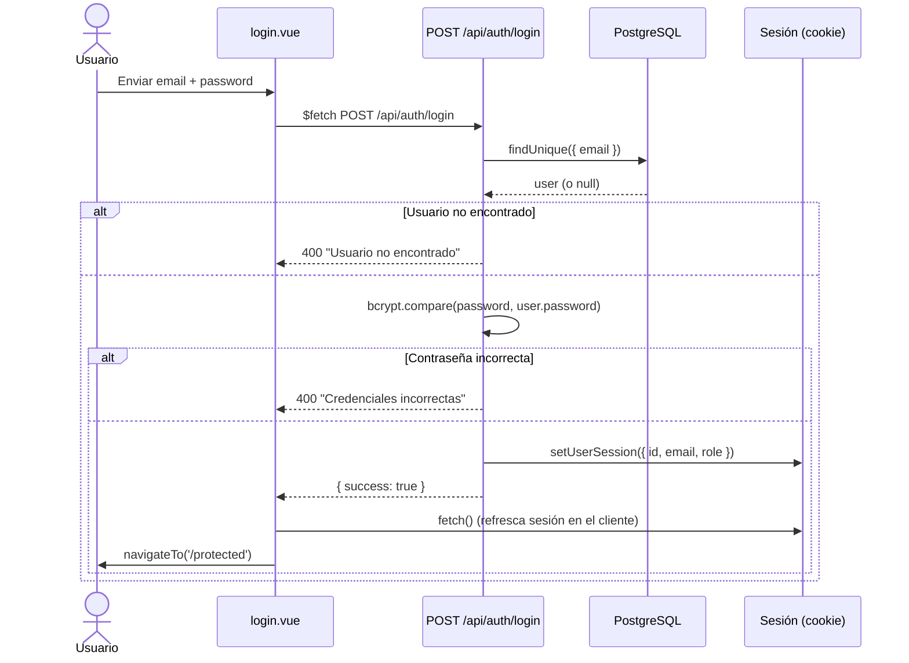
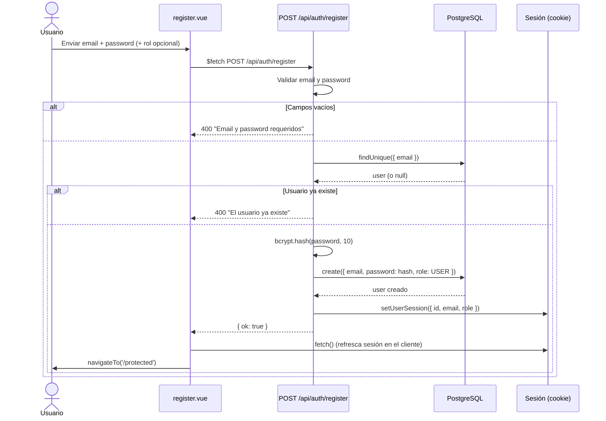
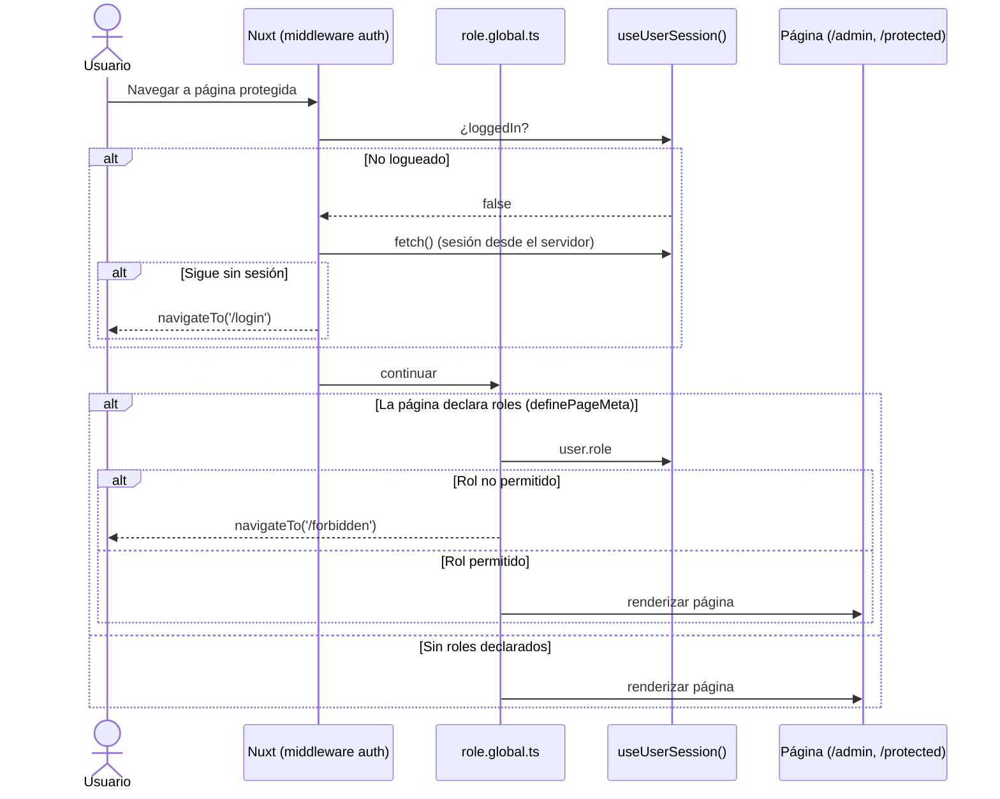
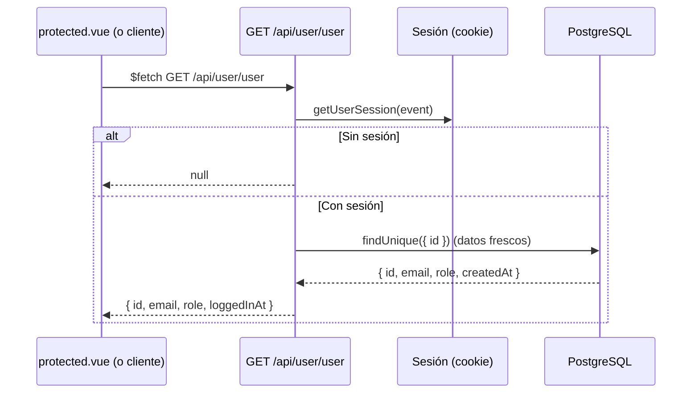
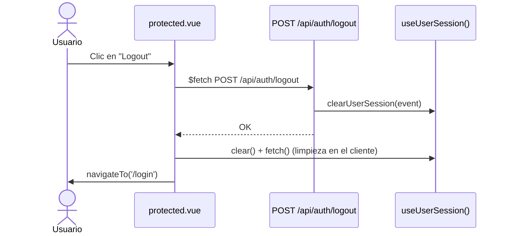

# Nuxt4-boilerplate

Boilerplate de Nuxt 4 con shadcn/ui, autenticación con sesiones y control de roles (RBAC) mediante Prisma y PostgreSQL.

## Stack

- **Nuxt 4** (Vue 3, SSR)
- **nuxt-auth-utils** — sesiones de usuario (`useUserSession`, `setUserSession`)
- **Prisma 7 + adapter-pg** — PostgreSQL
- **bcrypt** — hash de contraseñas
- **shadcn-nuxt + Tailwind CSS 4 + reka-ui**
- **Pinia**, **vee-validate + zod**, **nuxt-security**, **@nuxtjs/i18n**, **@nuxtjs/seo**

## Roles

Definidos como enum en `prisma/schema.prisma`:

| Rol | Descripción |
| --- | --- |
| `USER` | Rol por defecto al registrarse |
| `ADMIN` | Acceso al panel admin |
| `ROOT` | Acceso total (creado por el seed) |

Las páginas declaran los roles permitidos con `definePageMeta({ roles: [...] })` y el middleware global `app/middleware/role.global.ts` las protege. El tipo `RouteMeta.roles` se extiende en `app/types/page-meta.d.ts`.

## Setup

Requisitos: Node `24` (ver `.nvmrc`) y pnpm `10`.

```bash
cp .env.example .env   # rellena DATABASE_URL y NUXT_SESSION_PASSWORD
pnpm install
pnpm prisma:migrate    # aplica el schema a la base de datos
pnpm prisma:seed       # crea root@example.com / root1234 (ROOT)
pnpm dev
```

## Diagramas de secuencia

### Login (`POST /api/auth/login`)



### Registro (`POST /api/auth/register`)



### Navegación a página protegida con roles

Se ejecutan dos middleware: `auth.ts` (redirige a `/login` si no hay sesión) y `role.global.ts` (comprueba `to.meta.roles`).



### Datos del usuario autenticado (`GET /api/user/user`)



### Logout



## Estructura

```
app/
├── composables/useRole.ts      # rol actual del usuario (computed)
├── middleware/
│   ├── auth.ts                 # exige sesión / redirige si ya está logueado
│   └── role.global.ts          # protege páginas con definePageMeta({ roles })
├── pages/                      # login, register, protected, admin, root, forbidden
├── types/page-meta.d.ts        # extiende RouteMeta con `roles`
└── generated/prisma/           # cliente generado por Prisma
server/
├── api/auth/                   # login.post, register.post, logout.post
├── api/user/user.get.ts        # datos del usuario autenticado
└── utils/prisma.ts             # instancia de Prisma (adapter pg)
prisma/
├── schema.prisma               # modelo User + enum Role
└── seed.js                     # crea el usuario ROOT
shared/types/                   # tipos compartidos
```

## Scripts

| Script | Descripción |
| --- | --- |
| `pnpm dev` | Servidor de desarrollo |
| `pnpm build` | Build de producción |
| `pnpm typecheck` | Chequeo de tipos (vue-tsc) |
| `pnpm prisma:migrate` | Migración de desarrollo |
| `pnpm prisma:seed` | Crear usuario ROOT |

## Notas

- La sesión se guarda en una cookie cifrada con `NUXT_SESSION_PASSWORD` (mín. 32 caracteres); no hay JWT ni base de datos de sesiones.
- El rol se copia a la sesión en login/registro; `GET /api/user/user` refresca los datos desde la BD para no depender solo de la cookie.
